<div align="center">



# gitmsg

**A commit title, typed onto the line. You press Enter.**<br>
One subject for whatever is staged, from your own Grok login. No body. No commit until you say so.

<a href="#jack-in"></a>
<a href="#keys"></a>

<a href="https://omarchy.org"></a>

<kbd>[jack in](#jack-in)</kbd>&nbsp;
<kbd>[the line](#the-line)</kbd>&nbsp;
<kbd>[keys](#keys)</kbd>&nbsp;
<kbd>[faq](#faq)</kbd>

</div>

`gitmsg` reads what you have staged, asks Grok for a single commit title, and puts `git commit -m "<title>"` on the command line. It does not run it.


## Jack in

```sh
curl -fsSL https://raw.githubusercontent.com/uxeric/gitmsg/HEAD/install.sh | bash
```


## The line

Stage the change, then:

```sh
git add -p
gitmsg
```

A single line spins `Generating` while the title is written. When it finishes, the prompt is holding something like:

```sh
git commit -m "Adds farewell & updates the greeting"
```


## Keys

1. Install the Grok CLI if `grok` is not already on your PATH:

```sh
curl -fsSL https://x.ai/cli/install.sh | bash
```

2. Sign in. A browser opens, and Grok writes the session to `~/.grok/auth.json` on your machine:

```sh
grok login
```

No browser on that machine:

```sh
grok login --device-auth
```

3. Leave that file alone. `ls -l ~/.grok/auth.json` should show `-rw-------`. Do not commit it, do not paste it into this repo, and do not copy it into a script. If the login is missing or stale, `gitmsg` stops and tells you to run `grok login` again. It refreshes the session when it is near expiry.

An `XAI_API_KEY` in the environment is not read. The login file is the only credential.

| If you want to point it somewhere | |
|---|---|
| `GITMSG_MODEL` | Model id. Otherwise `[models] default` in `~/.grok/config.toml`, otherwise `grok-4.7`. |
| `GITMSG_EFFORT` | Reasoning effort. Default `low`. |
| `GROK_HOME` | Directory that holds `auth.json`, if it is not `~/.grok`. |


## FAQ

> [!NOTE]
> **Does it commit?**<br>
> No. The line sits on the prompt. Enter is the commit. Everything else is you changing your mind.

> [!IMPORTANT]
> **Where do I put the key?**<br>
> You don't put it in the project. Run `grok login`. The session stays in `~/.grok/auth.json`, which is not part of this repo.

<div align="center">
<br>


<sub><code>// not committed</code></sub>

</div>
